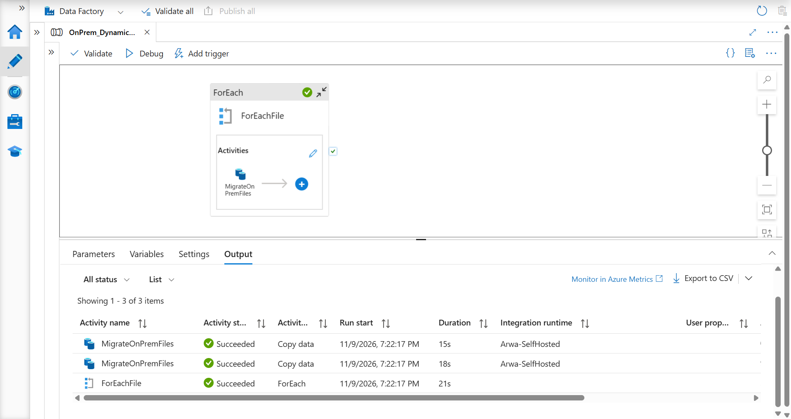
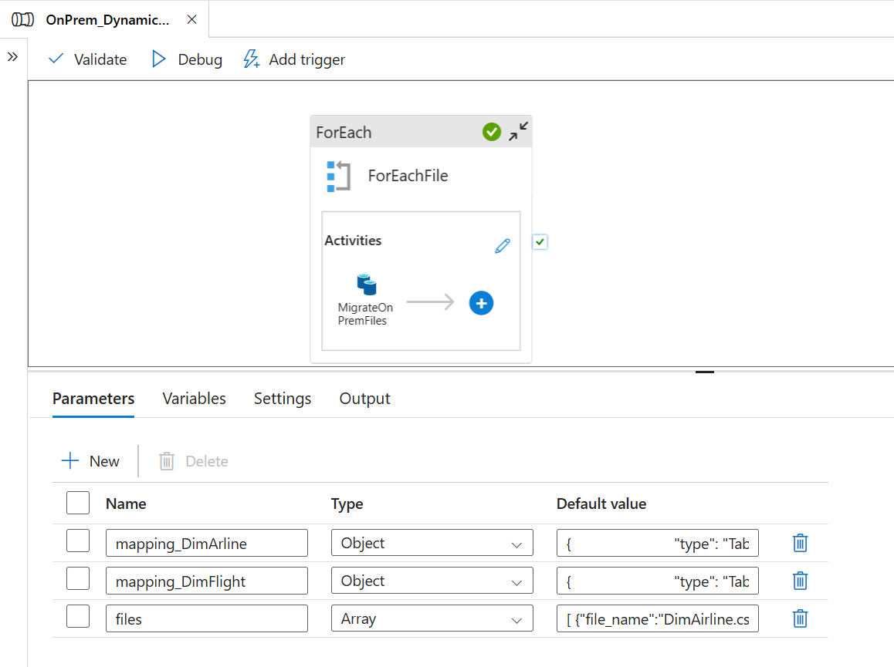
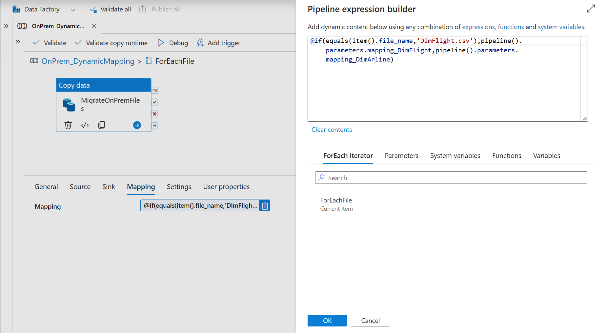
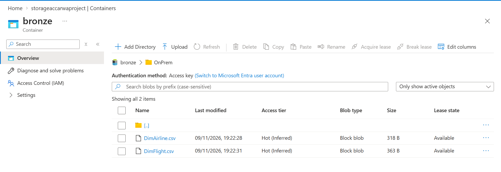

# ADF: Dynamic Column Mapping in a Copy Activity

An Azure Data Factory (ADF) pipeline that copies several CSV files with **one** Copy Data activity, while applying a **different column mapping to each file**. The mapping for each file is stored in a **pipeline parameter**, and an expression picks the right one at run time.



> This project builds on [ADF-OnPrem-to-DataLake-Dynamic-Copy](https://github.com/arwak-codes/ADF-OnPrem-to-DataLake-Dynamic-Copy). The linked services, datasets, and sample CSV files are the same, so they are not repeated here. See that repo for their setup.

## The idea in plain words

Imagine a mail sorter with one conveyor belt and two kinds of parcels. A label on each parcel tells the sorter which shelf layout to use. Here the "parcel" is a CSV file, and the "label" is its file name. The pipeline reads the file name and chooses the matching column mapping, so a single Copy activity can handle files with different columns.

## What it does

1. The pipeline parameter `files` holds the list of files to copy.
2. **ForEach** loops through the list.
3. For each file, **Copy Data** copies it from the local folder (through the self-hosted integration runtime) to Azure Data Lake Storage Gen2.
4. The Copy activity's **mapping** is chosen dynamically with an `@if` expression: if the file is `DimFlight.csv` it uses `mapping_DimFlight`, otherwise it uses `mapping_DimArline`.

```
files (array)
     │
     ▼
  ForEach
     │
     ▼
 Copy Data ── mapping = @if(file is DimFlight.csv → mapping_DimFlight, else → mapping_DimArline)
 C:\ADFTest\<file>  ──►  bronze/OnPrem/<file>
```

## Pipeline parameters

| Parameter | Type | Purpose |
|---|---|---|
| `files` | Array | List of file names to copy |
| `mapping_DimFlight` | Object | Column mapping for `DimFlight.csv` |
| `mapping_DimArline` | Object | Column mapping for `DimAirline.csv` |

> The airline mapping parameter is spelled `mapping_DimArline` (missing an "i") in the pipeline. I kept the name as it appears in the JSON so the expression matches.

`files` default value:

```json
[
  { "file_name": "DimAirline.csv" },
  { "file_name": "DimFlight.csv" }
]
```

Each mapping parameter holds a `TabularTranslator` object. The columns are:

| File | Mapped columns |
|---|---|
| `DimAirline.csv` | `airline_id`, `airline_name`, `country` |
| `DimFlight.csv` | `flight_id`, `flight_number`, `departure_time`, `arrival_time` |

In this project the source and sink column names are the same, so the data is copied as is. The goal is to demonstrate the mechanism. To rename a column, change the `sink` name in that file's mapping.



## The dynamic mapping expression

In the Copy activity, under **Mapping → Add dynamic content**:

```
@if(equals(item().file_name,'DimFlight.csv'),pipeline().parameters.mapping_DimFlight,pipeline().parameters.mapping_DimArline)
```

`item().file_name` is the file the ForEach loop is currently on. The same item also feeds the source and sink dataset parameters (`pickFile`, `putFile`), exactly as in the previous project.



## Components

| Component | Details |
|---|---|
| Pipeline | `OnPrem_DynamicMapping` |
| Activities | `ForEachFile` (ForEach), `MigrateOnPremFiles` (Copy data, retry set to 2) |
| Source dataset | `DynamicSource_FileServer` (local C: drive, via self-hosted integration runtime) |
| Sink dataset | `DynamicSink_FileServer` (Azure Data Lake Storage Gen2, `bronze/OnPrem`) |
| Integration runtime | `Arwa-SelfHosted` |

Datasets and linked services: see [ADF-OnPrem-to-DataLake-Dynamic-Copy](https://github.com/arwak-codes/ADF-OnPrem-to-DataLake-Dynamic-Copy).

## How to recreate it

1. Set up the linked services, datasets, and integration runtime from the [previous project](https://github.com/arwak-codes/ADF-OnPrem-to-DataLake-Dynamic-Copy).
2. Create a pipeline with a ForEach (Items: `@pipeline().parameters.files`) containing a Copy data activity, as before.
3. In the Copy activity, open the **Mapping** tab, click **Import schemas**, and set up the column mapping for one file.
4. Open the pipeline's **{ }** code view and copy the `translator` object. Create an **Object** parameter (for example `mapping_DimFlight`) and paste it as the default value. Repeat for the other file.
5. Go back to the Copy activity's Mapping tab and add the dynamic content expression above.
6. **Publish all**, then **Debug**. Check that both Copy runs succeed in the **Output** tab.

## Result

Both files are copied successfully, each with its own mapping, into `bronze/OnPrem` in the data lake.



## Project files

```
pipeline/
└── OnPrem_DynamicMapping.json
images/
```

Exported from ADF Studio using the **{ }** code view. Linked services are intentionally not included because they can contain credentials.
